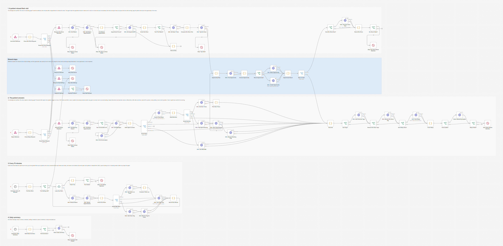
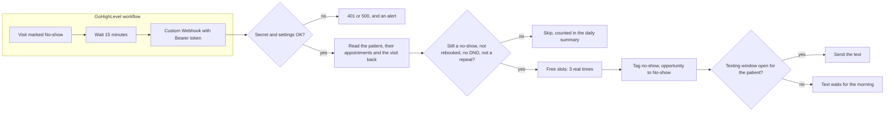
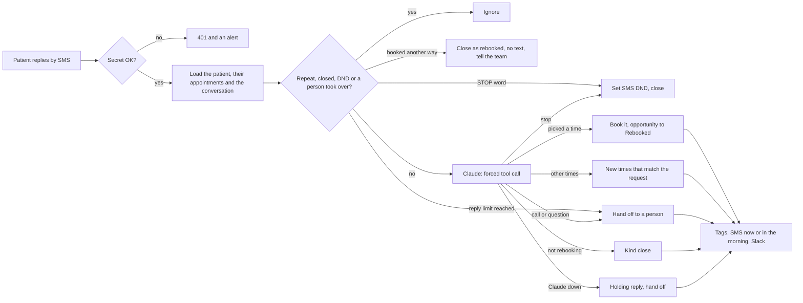
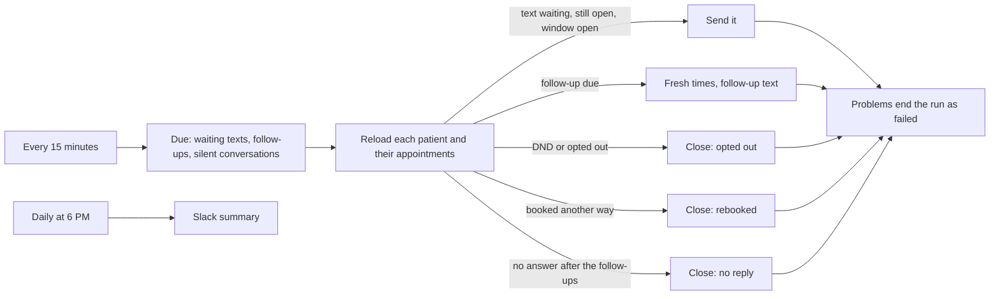

# GoHighLevel No-Show Rebooking Agent: Claude + n8n

When a patient misses a visit, a native GoHighLevel workflow tells n8n. n8n checks that the no-show is real, texts a kind message with real open times, lets Claude understand the answer and books the new visit. Built with GoHighLevel workflows, n8n and Claude.



## The problem

Every appointment business has no-shows, and most of those patients would come back if someone asked them at the right moment. The front desk rarely has time to text each one, wait for an answer and go back and forth about times. A generic "you missed your appointment" template reads like a telling off, offers no times, and the replies sit in the inbox until the patient has forgotten about it. Some no-shows are also not real: the patient arrived late, or someone clicked the wrong status, and a text would only annoy them.

## What this does

1. **GoHighLevel runs the calendar side natively.** One workflow confirms each booking and sends reminders 24 hours and 2 hours before the visit. When staff mark a visit No-show, a second workflow waits 15 minutes and calls n8n. A third forwards the patient's SMS replies. These are built by hand in GoHighLevel; the exact recipe (triggers, filters, every action, message texts, webhook settings) is in [ghl/native-workflows.md](ghl/native-workflows.md).
2. **Checks before anyone is texted.** n8n reads the appointment back from GoHighLevel. If it is no longer a no-show (staff fixed it during the wait), was cancelled, or the patient has already booked another visit, nobody is texted. The same goes for SMS DND, an earlier opt out, a missing phone number, a patient a person is already looking after (the `no-show-needs-human` tag) and a patient who is already in a rebooking conversation. A repeat delivery of the same no-show is ignored.
3. **Sends a kind text with real times.** "We missed you at your physio appointment today at 9:00 AM. No problem, things come up. Would one of these times work instead?" and three real open times from the calendar's free slots, one per day, with the same team member as the missed visit. No blame and no fees, unless the clinic sets its own policy sentence. Texts only go out between 9 AM and 7 PM in the patient's time zone; a no-show marked late in the evening is texted the next morning.
4. **Updates GoHighLevel.** The patient gets the `no-show` tag and their opportunity moves to the No-show stage (a won opportunity, a past sale, is never reopened).
5. **Lets Claude read the answers.** Claude picks one of six intents through a forced tool call. A picked time is booked and the opportunity moves to Rebooked. "Anything Thursday evening?" gets new real times that match. A request for a call or a question goes to a person. "No thanks" gets a kind close. STOP and the other opt out words set SMS DND in code, before any AI is involved. The patient's appointments are loaded with every reply, so someone who booked by phone in the meantime never gets a second visit: the agent stays quiet and tells the team.
6. **Follows up gently.** Patients who never answer get up to two follow-ups (after 24 and 72 hours by default), each with fresh times they have not seen, then the conversation is closed with a `no-show-no-reply` tag. Each patient is reloaded first, also before a text that waited for the morning: a booking made by phone, DND or a person taking over stops the agent.
7. **Keeps the team in the loop.** Slack gets an alert for every rebooking and every hand off, plus a daily summary: no-shows, rebooked, waiting, handed to a person, declined, no reply, opted out.
8. **Fails loudly.** Any GoHighLevel or Claude failure ends the run as failed, and the error workflow posts the reason and a link to the run in Slack. When a text could not be sent, the alert includes the exact text to send by hand.

## How it works

The no-show part. The GoHighLevel side is native; everything after the webhook runs in n8n:



The reply part. A GoHighLevel workflow (trigger Customer Replied, SMS, tag `no-show`) forwards each reply:



The scheduled part:



Both webhooks answer right away (200) and do the work afterwards, so GoHighLevel never waits.

**Why the no-show is read back.** The GoHighLevel workflow waits 15 minutes before it calls n8n, and n8n then reads the appointment through the API. If staff changed the status in the meantime, or the patient booked another visit, nothing is sent. HighLevel has no documented merge field for the appointment ID, so the webhook sends only the contact; n8n lists the patient's appointments and takes the newest one marked no-show in the calendar.

**Why nobody gets two texts.** A no-show is remembered by its appointment ID, and only one rebooking conversation per patient can be open. Replies have no message ID in GoHighLevel's workflow payload, so a reply is matched to the newest message with the same words in the conversation (from the last 24 hours) and that message's ID is remembered for 7 days. A rebooked visit gets the `no-show-agent-booked` tag a moment before it is created, so the reminder workflow skips its own confirmation (the agent already confirmed by text) and removes the tag.

**What happens at night.** Quiet hours apply to every text the agent sends, in the patient's own time zone. A reply that arrives at 3 AM is still read and acted on at once, so a picked time is booked before someone else takes it, but the confirmation waits in the agent's memory and the 15 minute run sends it when the window opens.

## Workflow at a glance

| Step | Nodes | What it does |
|---|---|---|
| 1 | No-Show Webhook, Check No-Show Request, Route No-Show Request, Respond: No-Show Received | POST webhook for the no-show workflow. Checks the Bearer secret (or `secret` custom data from the free Webhook action) and every setting, and answers 200 at once |
| 2 | Respond: Refused, Stop: Bad Secret, Respond: Bad Settings, Stop: Bad Settings, Respond: Ignored, Payload Problem?, Stop: Bad Payload | Shared by both webhooks: 401 for a wrong secret, 500 with the list of problems for bad settings, 200 for payloads that are ignored on purpose. A call with the right secret but no contact id also gets 200, then fails the run so the alert fires |
| 3 | GHL: Get Patient, GHL: Get Patient Appointments, Find Missed Appointment, Appointment Found?, GHL: Get Appointment, Stop: Patient Lookup Failed, Stop: No-Show Lookup Failed | Loads the contact and their appointments, picks the missed visit (the payload's appointment ID, or the newest no-show in the calendar) and reads it back. A lookup that fails ends the run as failed |
| 4 | Check No-Show, Text This Patient?, Record Skip | Still a no-show, the right calendar, not a repeat, not rebooked, no DND, not opted out, no person looking after them, no open conversation. Works out whether the texting window is open |
| 5 | GHL: Get Open Times, Compose No-Show Text, GHL: Tag No-Show, Stop: Tag Failed | Free slots for `SLOT_SEARCH_DAYS` with the same team member, 3 times one per day, the kind first text, the `no-show` tag. If the tag fails, nothing is sent and the run fails |
| 6 | Opportunity Plan, GHL: Find Opportunity, Choose Opportunity, Reuse Opportunity?, GHL: Move Opportunity, GHL: Create Opportunity, Opportunity Result, Back To Path | Shared opportunity step: moves the open (or else lost) opportunity to No-show, or later to Rebooked, or creates one. A won opportunity is never touched |
| 7 | Send No-Show Now?, GHL: Send No-Show Text, Record No-Show, No-Show Failed?, Stop: No-Show Needs Attention | Sends the text or keeps it for the morning, opens the conversation in the agent's memory and fails the run when something went wrong |
| 8 | Reply Webhook, Check Reply Request, Route Reply Request, Respond: Reply Received | POST webhook for replies. Reads the Custom Webhook body (JSON or form fields), the free Webhook action and the InboundMessage format |
| 9 | GHL: Get Replying Patient, Stop: Reply Lookup Failed, GHL: Get Reply Appointments, Has Conversation Id?, GHL: Find Conversation, GHL: Get Messages, Build Agent Context, Route Reply | Loads the patient (a patient who cannot be loaded fails the run), their appointments and the last 20 messages, skips repeats and closed conversations, handles STOP words, closes the conversation without a text when they booked another way, hands off at `MAX_AI_REPLIES`, builds the Claude request |
| 10 | Claude: Read Reply, Read Decision, Route Decision | One Claude call with a forced, strict tool call. A failed call, a missing tool call or `max_tokens` takes the safe fallback |
| 11 | GHL: Get New Times, Pick New Times | New times that match the days and time of day the patient asked for, never times they already saw (unless nothing else is open) |
| 12 | GHL: Flag Agent Booking, GHL: Book Appointment, GHL: Remove Booking Flag | Tags `no-show-agent-booked`, books the picked time (same length and team member as the missed visit, `toNotify` on) or removes the tag again if the booking fails |
| 13 | GHL: Set SMS DND | Sets SMS DND and keeps the contact's other DND channels as they were |
| 14 | Outcome, Add Tags?, GHL: Add Outcome Tags, Remove No-Show Tag?, GHL: Remove No-Show Tag, Send Reply Now?, GHL: Send Reply, Finish Reply | One place decides the text, the tags and the alert, and saves the agent's memory; then tags, removes `no-show` when the conversation ends, and texts now or in the morning |
| 15 | Post Update?, Slack: Rebooking Update, Reply Failed?, Stop: Reply Needs Attention | Slack for rebookings and hand offs. Anything that went wrong ends the run as failed |
| 16 | Schedule: Every 15 Minutes, Find Due Work, Tick Settings OK?, Loop: Due Work | Lists texts waiting for the morning, follow-ups that are due and silent conversations to close |
| 17 | GHL: Reload Patient, GHL: Reload Appointments, Check Due Work, Route Due Work | One patient per pass, with fresh data: send, follow up, close or wait. A contact GoHighLevel cannot find in 3 runs in a row (deleted or merged) is let go |
| 18 | GHL: Get Follow-up Times, Compose Follow-up, GHL: Send Due Text, GHL: Add Close Tag, GHL: Remove Tag On Close, Record Due Result | Follow-up texts with fresh times, waiting texts, and closing tags |
| 19 | Finish Tick, Tick Failed?, Stop: Tick Needs Attention | One failed run that lists every problem of the pass |
| 20 | Schedule: Daily Summary, Build Daily Summary, Post Summary?, Slack: Daily Summary, Stop: Summary Not Posted | The daily Slack summary at 6 PM (n8n's time zone), and housekeeping of old conversations |

## Tags it adds

With the default `TAG_PREFIX=no-show`:

| Tag | Meaning |
|---|---|
| `no-show` | In a rebooking conversation. The GoHighLevel reply workflow forwards only these patients' texts. Removed when the conversation ends |
| `no-show-agent-booked` | Set a moment before the agent books. The reminder workflow skips its confirmation and removes the tag |
| `no-show-rebooked` | Rebooked, by text or another way |
| `no-show-declined` | Did not want to rebook now |
| `no-show-no-reply` | No answer after the follow-ups |
| `no-show-needs-human` | A person should take over: a call or a question, the reply limit, a failed booking, Claude down. While it is on, the agent ignores the patient's texts and does not text them after another no-show. Remove it when you are done |
| `no-show-opted-out` | Replied STOP or asked to stop. SMS DND is on |

## What patients and the team see

A conversation from the test run (all data made up). The first text and the confirmation are written by the workflow; Claude only decided that "2 works for me" picks the second time:

```
Harbor Physio Clinic: Hi Sam, this is Harbor Physio Clinic. We missed you at your physio appointment today at 9:00 AM.
                      No problem, things come up. Would one of these times work instead?
                      1) Tue, Oct 27, 9:00 AM
                      2) Wed, Oct 28, 9:00 AM
                      3) Thu, Oct 29, 9:00 AM
                      Reply 1, 2 or 3 to book, or tell us a day that suits you.
                      Reply STOP to opt out.
Sam:                  2 works for me
Harbor Physio Clinic: You are booked for Wed, Oct 28, 9:00 AM. See you then! You will get the usual reminder before your visit.
```

The new visit is on the calendar with the same physio and the same 45 minutes as the missed one, the opportunity sits in the Rebooked stage, and Sam has the `no-show-rebooked` tag (the `no-show` tag is gone).

A patient who asks for something else gets real times that match (the first line comes from Claude, scripted in the test):

```
Ana:                  Do you have anything Thursday evening?
Harbor Physio Clinic: Sure, here is what we have:
                      1) Thu, Oct 29, 6:00 PM
                      Reply 1 to book.
```

In Slack (the time zone is a test zone; real patients show theirs, for example `America/Chicago`):

```
*No-show rebooked*: Sam Lee (+15550100101)
New visit: Wed, Oct 28, 9:00 AM (Etc/GMT+2). Missed: Mon, Oct 26, 9:00 AM
https://app.gohighlevel.com/v2/location/.../contacts/detail/...
```

```
*No-show patient needs a person*: Ben Ford (+15550100103)
They said: "Can someone call me? I have a question about my knee"
Agent replied: "Of course! Someone from the clinic will call you soon."
Wants a call about their knee
https://app.gohighlevel.com/v2/location/.../contacts/detail/...
```

```
*No-show rebooking, last 24 hours* (Harbor Physio Clinic)
No-shows: 35 (26 texted at once, 3 held for the morning, 1 text failed, 5 not texted: 1 no appointment marked no-show for this patient in the calendar, 1 the appointment was cancelled, 1 already rebooked, 1 SMS DND is on, 1 a person is looking after them (needs-human tag))
Rebooked by text: 4 (Sam Lee, Ana Cruz, Vic Ortiz, Zoe Lane). Booked another way: 3
Waiting for an answer: 7 (follow-ups sent: 4)
Handed to a person: 8 (Ben Ford, Oli Moss, Pia Gray, Quin Hale, Rae Kim, Tom Banks, Yan Cole, Ned Fox)
Did not want to rebook: 1. No reply after follow-ups: 1. Opted out: 4.
```

```
*No-show patient already rebooked*: Kai Reed (+15550100136)
They said: "2"
The agent did not answer or book, because they already have another visit booked (GoHighLevel start time 2026-10-28 15:00:00). Reply by hand if needed.
https://app.gohighlevel.com/v2/location/.../contacts/detail/...
```

## Setup

**You need:** self-hosted n8n reachable over HTTPS, a GoHighLevel sub-account with an SMS number, a calendar and a pipeline, an Anthropic API key and, optionally, a Slack incoming webhook.

1. Import `workflow/error-alert-slack.json` and **activate it**. n8n 2.x only runs an error workflow that is active.
2. Import `workflow/ghl-no-show-rebooking-agent.json`. In its settings, choose the error alert workflow as its **Error Workflow**.
3. Add the variables below to your n8n environment and restart n8n. The nodes read them with `$env`, so self-hosted n8n needs `N8N_BLOCK_ENV_ACCESS_IN_NODE=false`. (n8n Cloud does not allow `$env`. There, replace `$env.` with `$vars.` and create the same names under Variables.)
4. Activate the workflow. It listens on `/webhook/ghl-no-show` (no-shows) and `/webhook/ghl-no-show-reply` (replies), and runs every 15 minutes plus once a day at 6 PM.
5. Build the three native GoHighLevel workflows from [ghl/native-workflows.md](ghl/native-workflows.md).
6. Mark a test appointment of your own as No-show and answer the text.

Step by step, with the token scopes, the IDs, the first test and troubleshooting: [docs/setup.md](docs/setup.md).

| Variable | Required | Where to find it |
|---|---|---|
| `GHL_API_KEY` | yes | GoHighLevel → Settings → Private Integrations. Token starts with `pit-`. The 10 scopes it needs are listed in [docs/setup.md](docs/setup.md) |
| `GHL_LOCATION_ID` | yes | GoHighLevel → Settings → Business Profile |
| `GHL_CALENDAR_ID` | yes | The calendar's settings page (the ID is in the URL), or the API call in the setup guide |
| `GHL_PIPELINE_ID`, `GHL_NO_SHOW_STAGE_ID`, `GHL_REBOOKED_STAGE_ID` | yes | `GET /opportunities/pipelines` (one curl call, shown in the setup guide) |
| `GHL_WEBHOOK_SECRET` | yes | Your own random string of at least 16 characters, for example from `openssl rand -hex 32` (the example value in `.env.example` is refused). The same value goes into the Bearer Token of both Custom Webhook actions |
| `ANTHROPIC_API_KEY` | yes | console.anthropic.com → API keys |
| `ANTHROPIC_MODEL` | no | Default `claude-sonnet-5`. `claude-haiku-4-5` is cheaper, `claude-opus-5` also works. `claude-opus-5-5` and the Claude Fable and Mythos models do not: they refuse a forced tool call (and thinking turned off), so with one of them the webhooks answer 500 and name the problem |
| `BUSINESS_NAME`, `BUSINESS_ABOUT` | recommended | The name in the texts, and one line about the business for Claude |
| `VISIT_NAME` | no | What the texts call the visit (default "appointment") |
| `NO_SHOW_POLICY_TEXT` | no | Your own sentence about missed visits, added to the first text. Empty (the default) means no mention of fees |
| `TAG_PREFIX` | no | Prefix of the tags the agent adds (default `no-show`). The GoHighLevel workflows filter on these names |
| `SAME_STAFF` | no | `true` (default): offer and book times with the same team member as the missed visit |
| `SLOT_SEARCH_DAYS` | no | How far ahead to look for open times (default 7, at most 30) |
| `SEND_HOUR_START`, `SEND_HOUR_END` | no | Texting window in the patient's local time (default 9 to 19) |
| `BUSINESS_TZ` | no | Time zone for patients without one, and for appointment times GoHighLevel sends without an offset (default `America/New_York`) |
| `FOLLOW_UP_HOURS` | no | Up to two follow-ups, in hours after the first text (default `24,72`; empty means none) |
| `CLOSE_AFTER_HOURS` | no | When a silent conversation is closed (default 120) |
| `MAX_AI_REPLIES` | no | Agent replies per patient before a person takes over (default 4) |
| `GHL_FROM_NUMBER` | no | Number the texts go out from (default: the location's default number) |
| `GHL_APP_URL` | no | Your white label app domain, for contact links in Slack |
| `SLACK_WEBHOOK_URL` | no | Slack incoming webhook for rebookings, hand offs, the daily summary and error alerts. Leave it empty to skip Slack |

Only text people who agreed to hear from you. In the US, sending SMS through a GoHighLevel number also needs A2P 10DLC registration.

## Testing

The n8n workflow was tested end to end on n8n 2.19.5 against **mock GoHighLevel, Claude and Slack APIs**, so no real account was touched and no real text was sent. The native GoHighLevel workflows were not run: the test sends the exact requests they send according to the recipe (Custom Webhook with a Bearer token, as JSON and as form fields, and the free Webhook action's documented payload).

The mock GoHighLevel keeps real state (contacts, tags, DND, appointments, a calendar with open times and three physios per slot, conversations, opportunities), serves the contact appointment list in a time zone 5 hours off the clinic's (GoHighLevel does not document that zone), and rejects what the real v2 API would reject: a wrong token, the wrong `Version` header for the endpoint, unknown body properties or query parameters, a free slots range over 31 days, a team member outside the calendar, a slot that is full, a second opportunity in the same pipeline, texts to contacts with DND. The mock Claude returns scripted answers but rejects malformed Messages API requests, including a forced tool call with thinking left on. The real Claude requests were also checked against Anthropic's free token counting endpoint.

The test also imports and activates the error alert workflow and checks that exactly the runs that should fail failed, each with one alert linked to it.

All 83 checks across 61 scenarios pass:

| Scenario | Result |
|---|---|
| Webhooks with a wrong or missing secret | 401, nothing loaded or sent, alert |
| Broken settings (including a Claude model that refuses the request) | 500 listing every problem, no API call, alert with the same list |
| No-show (Custom Webhook, JSON) | Visit read back, 3 real times with the same physio, kind text with no blame or fees, tagged before the text, a 429 retried into exactly one text, opportunity to No-show |
| No-show (free Webhook action payload, form-encoded Custom Webhook) | Both read; appointment ID taken from `calendar.appointmentId`; a missing opportunity is created; a won one is never reopened |
| Same no-show twice, status fixed during the wait, cancelled, already rebooked, SMS DND, another calendar, another location, a person already looking after the patient | Nothing sent |
| An earlier visit the same morning, with the appointment list in another time zone | Not mistaken for a rebooking: the patient is texted |
| Right secret but an empty contact id merge field | 200, then a failed run and an alert |
| No-show at 3 AM for the patient | Tag and opportunity at once, the text waits; the morning run sends it word for word. A patient who booked by phone overnight gets no morning text; a morning text that is rejected ends the conversation with the text to send by hand |
| Calendar down / appointment unreadable / tag fails / text rejected | Kind text without times and a flagged run / nothing sent / nothing sent / the text to send by hand |
| Patient picks a time | Claude request checked, flag tag, then the booking (same length and physio, `toNotify` on), opportunity to Rebooked, confirmation, tags, Slack alert |
| Patient asks for another day and time | Only matching real times, then "1" books that time |
| Wants a call, does not want to rebook, STOP, "please stop texting me" | Hand off with Slack alert / kind close / SMS DND with other channels kept / Claude reads it as stop |
| Claude down, down with an opt out word, no tool call, `max_tokens` | Holding reply (or none when it may be an opt out), needs-human tag, flagged run |
| Picked time just filled / has passed | Honest text and hand off, flag tag removed / new times she has not seen |
| "2" from a patient who booked by phone in the meantime | No Claude call, no second booking, no text; closed as rebooked, Slack note with their words |
| Opportunity update fails / DND update fails / reply text rejected | Still confirmed, flagged / URGENT alert / the text to send by hand |
| Reply limit, `<!here>` in a reply, repeat delivery, no conversation, email, unknown contact, no history | Hand off / escaped in Slack / ignored / ignored / ignored / flagged / answered and flagged |
| Patient answers at 3 AM | Booked at once, confirmation sent by the morning run |
| Follow-ups | After 24 hours with fresh times, quiet hours respected, last follow-up after 72 hours, closed as no reply after 120; booked by phone or DND closes the conversation; one rejected follow-up does not stop the others; after n8n was down for days, the second follow-up does not follow the late first one 15 minutes later; a contact deleted in GoHighLevel is let go after 3 runs |
| Daily summary, saved executions, real schedule trigger, policy text, example secret | Counts and names in Slack; no API key in any saved run and the Bearer secret hidden; the 15 minute schedule fires by itself; the clinic's policy sentence appears in the first text; the `.env.example` secret is refused as a broken setting |

Full results, the requests the workflow sent and the API docs they were checked against: [docs/test-report.md](docs/test-report.md). Run the same tests yourself with [tests/e2e_mock_test.py](tests/e2e_mock_test.py). What testing found and fixed is in [CHANGELOG.md](CHANGELOG.md).

## What it handles when things go wrong

| Situation | What happens |
|---|---|
| A forged call to either webhook | 401, nothing loaded or sent, and an alert. An empty secret setting refuses everything, and a secret under 16 characters or left at the example value counts as a broken setting |
| A setting is missing or wrong | The webhooks answer 500 with the list, the schedule fails the run with the same list |
| A GoHighLevel action sends the right secret but no contact id (a merge field that did not fill) | 200, then a failed run and an alert, so a no-show is not dropped quietly |
| The patient books by phone after the first text | A text that waited for the morning is dropped, follow-ups stop, and a reply such as "2" books nothing: the conversation is closed as rebooked and the team gets a Slack note with what they wrote |
| A text that waited for the morning cannot be sent | The alert includes the exact text to send by hand, and the conversation ends instead of staying open |
| The contact is deleted or merged in GoHighLevel | The 15 minute run reports it; after 3 runs in a row that cannot find the contact, the agent lets go instead of failing every 15 minutes |
| A no-show that is not real any more | The visit is read back after the 15 minute wait; a changed status, a cancellation or a newer booking means no text |
| GoHighLevel rate limit or a short outage | API calls are retried 3 times, 2 seconds apart. The booking and a new opportunity are not retried, because they must never happen twice |
| The calendar is down when a no-show comes in | The patient still gets a kind text asking for a day that suits them, and the run is flagged |
| The first text is rejected | The alert includes the exact text to send by hand, and the agent will not text them about this visit |
| Claude is down, answers without the tool call or stops at `max_tokens` | A holding reply (none if the message may be an opt out), the needs-human tag and a flagged run with the patient's words |
| The picked time filled up meanwhile | GoHighLevel refuses the booking, the patient is told someone will confirm a time, the flag tag is removed and the team is alerted |
| The patient picks a time that has passed | The other times keep their numbers; a passed time gets new times instead of a booking |
| The patient texts STOP | SMS DND is set before any AI call. If GoHighLevel refuses the update, an URGENT alert says to set it by hand |
| The booking works but the opportunity update fails | The patient is still confirmed; the alert says what to finish by hand |
| A follow-up is rejected | The other follow-ups still go out, and the run fails once at the end with the text to send by hand |
| A follow-up goes out late (quiet hours, n8n was down) | The next follow-up and the close keep their own spacing from it, so they never follow 15 minutes later |
| A patient's text contains Slack markup such as `<!channel>` | Names, patient messages and Claude's replies are escaped before they reach Slack |

## Cost

The no-show text and the follow-ups do not use Claude. Each reply is one Claude call of about 1,600 to 2,000 input tokens (measured with Anthropic's token counter on the test conversations) and usually under 150 output tokens. On `claude-sonnet-5` ($2 per million input tokens, $10 per million output tokens) that is about half a cent per reply; on `claude-haiku-4-5` ($1 / $5) about a quarter of a cent.

On the GoHighLevel side, each no-show and each forwarded reply is one Custom Webhook execution. HighLevel lists Custom Webhook as a premium action: $0.01 per execution after 100 free lifetime premium executions per sub-account. SMS is billed by GoHighLevel at your LC Phone rates.

## Limitations and next steps

- The native GoHighLevel workflows are a recipe, checked against HighLevel's help center and API docs but not built or run in a live sub-account for this repo. A few points are only partly documented (for example whether an appointment created through the API starts the reminder workflow); they are listed at the end of [ghl/native-workflows.md](ghl/native-workflows.md). Build them in a sandbox first and check those points.
- The n8n side was tested against mocks built from GoHighLevel's published OpenAPI files, not a live account. GoHighLevel documents the contact appointment list with times like `2021-07-16 11:00:00`, without an offset and without saying which time zone. The workflow only compares those times with each other (with the missed visit's own entry in the same list), so the zone does not matter; the test serves them in a zone 5 hours off the clinic's to prove it. Times shown to patients come from the single appointment read, which has an offset in GoHighLevel's docs; a time without one is read in `BUSINESS_TZ`. Check one real response of each before going live.
- A patient who already has a later visit booked when they miss one (for example the next visit of a series) counts as rebooked and is not texted.
- The agent's memory (open conversations, offered times, handled message IDs, the daily summary log) lives in n8n's workflow static data. n8n saves it as one block per workflow after each run that changed it. Runs that change nothing (an idle 15 minute run, an ignored reply) leave it alone, but two runs that both change it at the same moment can overwrite each other's changes, for example a reply and a 15 minute run that sends follow-ups. The reload before every follow-up catches a lost booking, opt out or hand off, but a lost "declined" can bring one follow-up too many. Two copies of the same reply that arrive within seconds of each other can both be handled, in the worst case as two bookings (a copy that arrives after the first booking exists is caught by the appointment check). At higher volume, move the memory to Postgres, Redis or an n8n data table.
- GoHighLevel has no idempotency key for sending messages. If a send times out after GoHighLevel already accepted it, the retry can send the same text twice.
- The Custom Webhook from the recipe sends no appointment ID (HighLevel documents no merge field for it), so the agent takes the patient's newest no-show in the calendar. A patient who misses two visits in one day gets one conversation, about the later visit.
- One rebooking conversation per patient at a time. A second no-show while a conversation is open is skipped (and counted in the daily summary).
- Texts that wait for quiet hours to end, and follow-ups, go out on the 15 minute schedule, so up to 15 minutes after the window opens.
- Booking only creates the appointment. Rescheduling and cancelling stay with your team.
- Every refused webhook call raises a Slack alert. That is useful as a warning, but a flood of forged calls would also flood Slack; put n8n behind a proxy with rate limits for public use.
- API keys are read from environment variables. For production, move them into n8n credentials.
- The prompts, the texts and the time labels are written in English (en-US). The daily summary runs at 6 PM in n8n's time zone; change it in the **Schedule: Daily Summary** node.

## About

Built by **Romiel Inolino**, AI and CRM Automation Specialist working with GoHighLevel, Monday.com, ClickUp, n8n, Make and Zapier.
Portfolio and case studies: [romielwillautomate.dev](https://romielwillautomate.dev)

This repository is a portfolio implementation. Credentials, API keys and customer data are not included, and all test data is made up.
